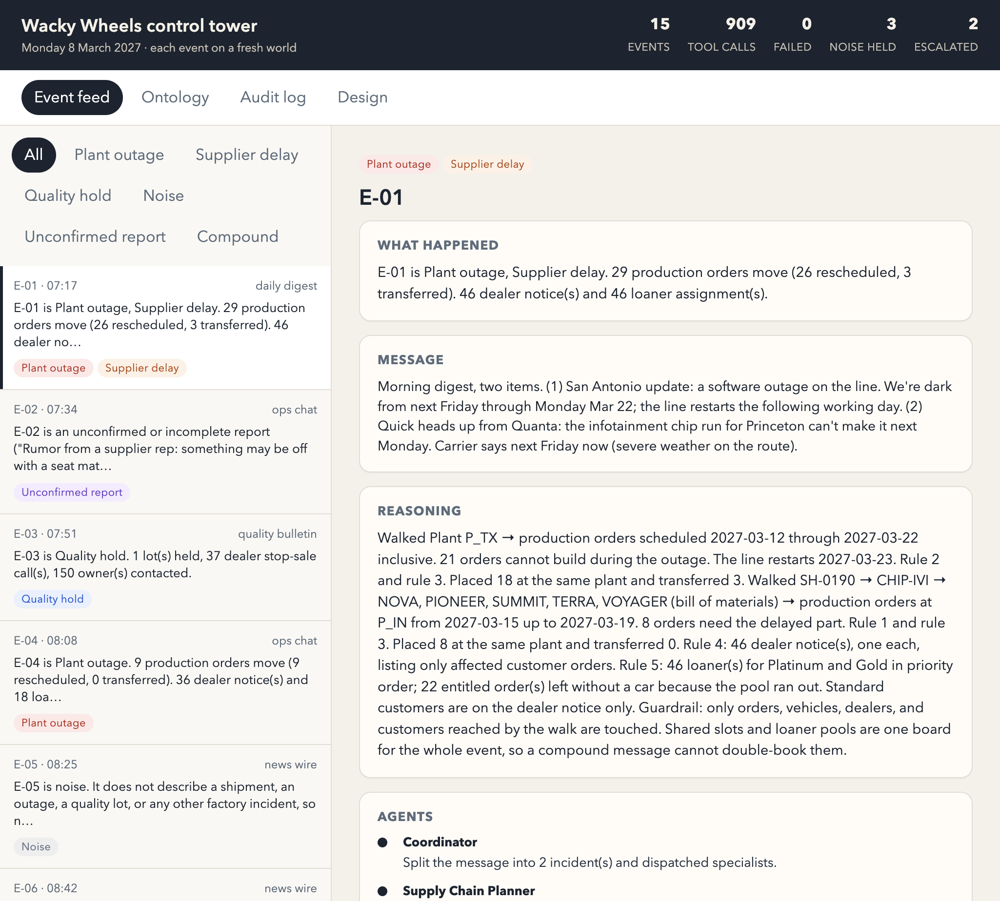
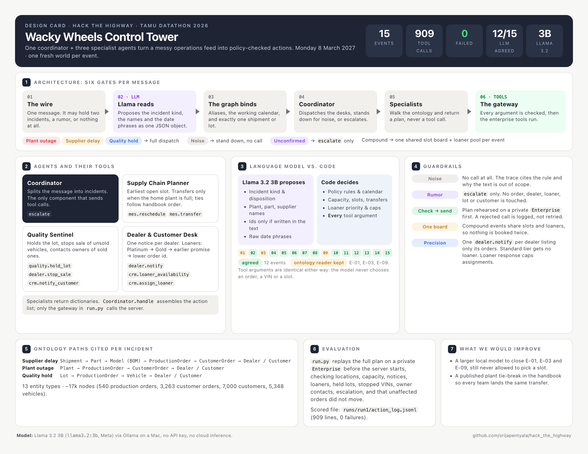
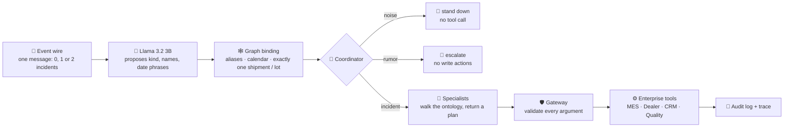
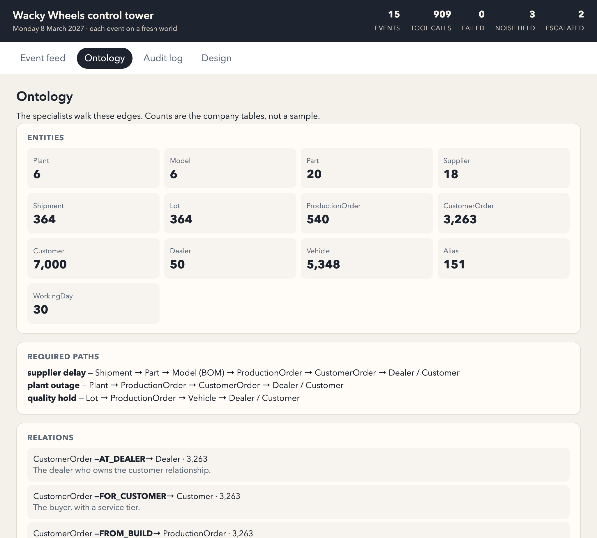
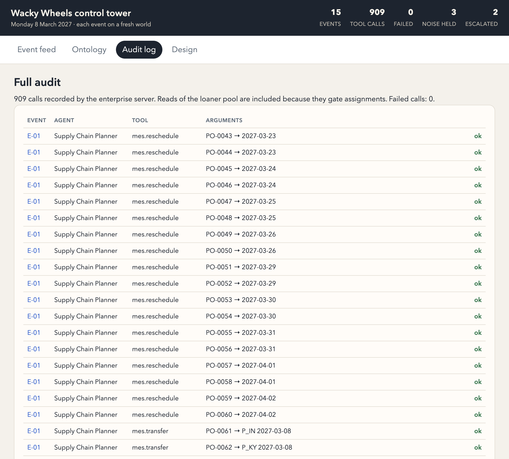

<div align="center">

# 🛣️ Hack the Highway

### An event-driven, multi-agent control tower for a just-in-time automaker

**Four agents run a car plant from a messy morning feed — and they refuse to guess.**


-7C3AED)


*Built at TAMU Datathon 2026 for the **Hack the Highway** challenge.*



</div>

---

## The problem

**Wacky Wheels Co.** builds cars with **zero parts inventory**. When one chip shipment is late, one assembly line goes dark, or one part lot turns out to be defective, the right production orders have to move, the right dealers have to be told, the right customers need loaner cars, and **everything else must be left alone**.

The incoming messages are messy, like real ones:

- 🗓️ relative dates — *"dark from next Friday through Monday Mar 22"*
- 🏷️ nicknames and aliases — *"the Kentucky plant"*, *"the infotainment chip run for Princeton"*
- 📦 **two incidents in one digest**, which share the same slots and loaner pools
- 🗣️ **rumors** — *"something may be off with a seat material… nothing confirmed"*
- 📰 **noise** — *"Dealer Amarillo asks where to find the new brochure PDF"*

## What it does

Hack the Highway reads each event, uses a **small local LLM** to understand it, binds it to a **knowledge graph** of the whole company, walks that graph to find every affected record, and then **executes the corrective actions** through the enterprise tools, following the policy handbook. Every decision comes with a **graph path and a written reason**.

| | |
|---|---|
| 🤖 **Multi-agent** | One coordinator plus three specialists, each with a clear job and its own tools |
| 🕸️ **Ontology-driven** | 13 entity types, ~17k nodes, typed edges; every action cites the path that justified it |
| 🛡️ **Guardrailed** | The LLM never picks an order, VIN or slot. Every tool argument is computed and validated by code |
| 🙋 **Human in the loop** | Unconfirmed reports are escalated with **zero** write actions |
| 🔍 **Explainable** | Per-event trace, reasoning summary, ontology export and a full audit trail |
| 💸 **Cheap** | Llama 3.2 3B on a laptop through Ollama. No API key, no cloud bill |

## Results — official run (`runs/run1`)

> **15 events · 909 tool calls · 0 failures · 3 noise events left untouched · 2 rumors escalated**

| Event | Category | What the tower did | Calls |
|---|---|---|---:|
| E-01 | 🔀 Compound (plant outage + supplier delay) | 26 orders rescheduled, 3 transferred · 46 dealer notices · 46 loaners | 153 |
| E-02 | ❓ Unconfirmed report | `escalate` only | 1 |
| E-03 | 🧪 Quality hold | 1 lot held · 37 stop-sale calls · 150 owners contacted | 188 |
| E-04 | 🏭 Plant outage | 9 rescheduled · 36 dealer notices · 18 loaners | 81 |
| E-05 – E-07 | 📰 Noise | **No action** | 0 |
| E-08 | 🏭 Plant outage | 6 rescheduled · 25 dealer notices · 15 loaners | 57 |
| E-09 | 🚚 Supplier delay | 4 rescheduled, 2 transferred · 26 dealer notices · 10 loaners | 51 |
| E-10 | 🚚 Supplier delay | 3 rescheduled · 18 dealer notices · 7 loaners | 35 |
| E-11 | 🏭 Plant outage | 6 rescheduled, 3 transferred · 36 dealer notices · 17 loaners | 75 |
| E-12 | 🚚 Supplier delay | 3 rescheduled · 14 dealer notices · 10 loaners | 34 |
| E-13 | ❓ Unconfirmed report | `escalate` only | 1 |
| E-14 | 🧪 Quality hold | 1 lot held · 36 stop-sale calls · 94 owners contacted | 131 |
| E-15 | 🧪 Quality hold | 1 lot held · 25 stop-sale calls · 76 owners contacted | 102 |

<sub>"Calls" also counts `crm.loaner_availability` checks made before each loaner assignment. Source: `runs/run1/action_log.jsonl` and `runs/run1/report.json`.</sub>

## 🗂️ Design card

The one-page design card covers the architecture, agents, LLM vs. code split, guardrails, ontology paths, evaluation, and next steps. Each section is explained in detail below.

<p align="center"><a href="solution/design_card.pdf"></a></p>

<p align="center">📄 <a href="solution/design_card.pdf"><b>Download the design card (PDF)</b></a></p>

## Architecture

Each message passes through six gates. There is one ontology, and within an event there is one shared slot board and one shared loaner pool, so a compound message can never double-book anything.



### The agents

| Agent | Responsibility | Tools |
|---|---|---|
| **Coordinator** | Splits the message into incidents, dispatches the specialists, and is the only component that sends tool calls | `escalate` |
| **Supply Chain Planner** | Finds the earliest open slot; transfers to another plant only when the home plant is full | `mes.reschedule`, `mes.transfer` |
| **Quality Sentinel** | Holds the lot, stops sale of unsold vehicles, contacts owners of sold ones | `quality.hold_lot`, `dealer.stop_sale`, `crm.notify_customer` |
| **Dealer & Customer Desk** | Sends one notice per dealer and assigns loaners by priority: Platinum → Gold → earlier promise → lower order id | `dealer.notify`, `crm.loaner_availability`, `crm.assign_loaner` |

Specialists **return plans, not tool calls**. The coordinator collects those plans, rehearses them against the enterprise rules, and only then sends them.

### The knowledge graph



| Entities | Count | | Entities | Count |
|---|---:|---|---|---:|
| Plant | 6 | | ProductionOrder | 540 |
| Model | 6 | | CustomerOrder | 3,263 |
| Part | 20 | | Customer | 7,000 |
| Supplier | 18 | | Dealer | 50 |
| Shipment | 364 | | Vehicle | 5,348 |
| Lot | 364 | | Alias | 158 |
| WorkingDay | 30 | | | |

The tower traverses these paths and cites them for every action:

```
Supplier delay : Shipment → Part → Model → ProductionOrder → CustomerOrder → Dealer / Customer
Plant outage   : Plant → ProductionOrder → CustomerOrder → Dealer / Customer
Quality hold   : Lot → ProductionOrder → Vehicle → Dealer / Customer
```

The full export is in [`runs/run1/ontology.json`](runs/run1/ontology.json).

## LLM vs. code: who decides what

| The LLM (Llama 3.2 3B) does | Deterministic code does |
|---|---|
| Reads the free text | Applies the policy handbook rules |
| Proposes incident kind, plant, part, supplier, ids **written in the message**, and date phrases | Resolves dates against the working calendar |
| Returns exactly one JSON object | Computes capacity, slots, and transfer targets |
| | Ranks loaners and caps assignments by availability |
| | Builds **every** tool argument from the graph walk |

The model is prompted **not to choose actions and not to invent ids**. Order ids, VINs and slots aren't even fields in its output schema.

In the official run, Llama agreed with the ontology reader on **12 of 15** events. On E-01, E-03 and E-09 its proposal did not bind cleanly to the graph, so the ontology reader stayed in force and the tool arguments didn't change. That is the guardrail doing its job.

## Guardrails

- 📰 **Noise** → no tool call at all.
- ❓ **Rumor** → `escalate` only. No order, dealer or customer is touched.
- ✅ **Check, then send** → the whole plan is rehearsed on a private copy of the enterprise first. A rejected call is logged and not blindly retried. Loaner responses cap assignments.
- 🧮 **One board per event** → compound messages share slots and loaner pools, so nothing is booked twice.
- 🎯 **Precision** → one `dealer.notify` per dealer, listing only that dealer's affected orders. Standard-tier customers get no loaner. Unaffected orders never move.

## Evaluation

`solution/run.py` replays the full plan on a private copy of the `Enterprise` **before** the tool server starts. It checks:

- production order locations and plant capacity
- dealer notices (one per dealer, only affected orders)
- loaner assignments against pool limits and priority
- held lots, stopped VINs, and owner contacts
- escalation for unconfirmed reports
- that **unaffected orders did not move**

Only after the rehearsal passes is the plan sent to the real server. The scored file is [`runs/run1/action_log.jsonl`](runs/run1/action_log.jsonl): 909 lines, 0 failures.

## The control tower UI

| Event feed | Audit log |
|---|---|
|  |  |

The UI offers an **event feed** filterable by category, a per-event **what happened / message / reasoning / agents** breakdown, an interactive **ontology** view, a complete **audit log**, and the **design card**.

## Quickstart

Everything core is **Python standard library only**. Run from the repository root:

```bash
# 1. Plan every event, rehearse against the rules, then execute and write runs/run1
python3 solution/run.py

# 2. Open the control tower
python3 solution/control_tower.py          # → http://127.0.0.1:8090
```

Optional modes:

```bash
python3 solution/run.py --rehearse-only    # policy check only, no server
python3 solution/run.py --llm              # read each event with Llama 3.2 3B via Ollama
```

For `--llm`, run `ollama serve` with `llama3.2:3b` pulled (`ollama pull llama3.2:3b`). If `OPENAI_API_KEY` is set, that is used instead.

<details>
<summary><b>Extras: Streamlit board and MongoDB Atlas mirror</b></summary>

```bash
pip install streamlit plotly
streamlit run solution/showcase.py --server.port 8501

pip install pymongo certifi
MONGODB_URI='mongodb+srv://...' python3 solution/load_atlas.py
MONGODB_URI='mongodb+srv://...' python3 solution/control_tower.py --atlas
```

The Atlas mirror is read-only with respect to the run. It never calls enterprise tools or rewrites the action log.
</details>

## Repository layout

```
.
├── solution/
│   ├── run.py              # plan → rehearse → execute; writes runs/run1
│   ├── control_tower.py    # serves the control-tower UI
│   ├── showcase.py         # optional Streamlit board
│   ├── load_atlas.py       # optional MongoDB Atlas mirror
│   ├── design_card.pdf     # one-page design card (also .png, source .html)
│   ├── static/index.html   # control-tower front end
│   └── tower/
│       ├── agents.py       # Coordinator + 3 specialists
│       ├── world.py        # ontology / knowledge graph over the company tables
│       ├── understand.py   # ontology reader: aliases, dates, incident binding
│       ├── llm.py          # Llama 3.2 3B reader (Ollama / OpenAI)
│       ├── policy.py       # slot board, loaner ranking, dealer notice groups
│       ├── execute.py      # validating gateway to the enterprise tools
│       └── atlas.py        # Atlas publishing helpers
├── runs/run1/
│   ├── action_log.jsonl    # 📒 the scored action log (909 calls)
│   ├── report.json         # run summary + ontology stats
│   ├── ontology.json       # ontology export
│   ├── traces/E-01..E-15   # per-event graph path + reasoning
│   └── demo/               # screenshots
├── data/                   # company tables, events, policy handbook (provided)
├── enterprise.py           # mock enterprise tools (provided, unchanged)
├── enterprise_server.py    # local tool server (provided, unchanged)
└── submission/             # Devpost write-up and article drafts
```

## Submission checklist

Every deliverable from the challenge brief, and where to find it:

| Requirement | Where |
|---|---|
| `action_log.jsonl` from the run on all 15 events | [`runs/run1/action_log.jsonl`](runs/run1/action_log.jsonl) — 909 calls, 0 failed |
| Source code | [`solution/`](solution/) |
| Ontology / graph export or diagram | [`runs/run1/ontology.json`](runs/run1/ontology.json) · [ontology screenshot](runs/run1/demo/tower-ontology.png) · [graph paths above](#the-knowledge-graph) |
| A trace for each event | [`runs/run1/traces/E-01.json` … `E-15.json`](runs/run1/traces/) |
| Graph path per incident (one per incident for compound E-01) | `paths` field in each trace; E-01 has two |
| Summary + reason for every event, including what it did **not** do | `summary` and `reasoning` fields in each trace (noise and rumors cite the handbook rule) |
| Demo screenshots: events arriving, graph path, agents acting, audit trail | [`runs/run1/demo/`](runs/run1/demo/) |
| One-page design card (architecture, LLM vs code, guardrails, evaluation, improvements) | [`solution/design_card.pdf`](solution/design_card.pdf) · [PNG](solution/design_card.png) |
| Model cited | Llama 3.2 3B — see below |

## Model citation

**Llama 3.2 3B** (`llama3.2:3b`), Meta, run locally through **Ollama** on a Mac. No API key and no cloud inference were used for the official run.

## What we'd improve next

- A slightly larger local model to close the three events where the LLM reading did not bind (E-01, E-03, E-09), still without letting it pick a slot.
- A published plant tie-break rule in the handbook, so transfers are reproducible across teams.
- Streaming ingestion, so the tower reacts to events live instead of in a batch.

---

<div align="center">
<sub>Wacky Wheels Co., its data, and the enterprise tool mocks were provided by the Hack the Highway challenge organizers.</sub>
</div>
